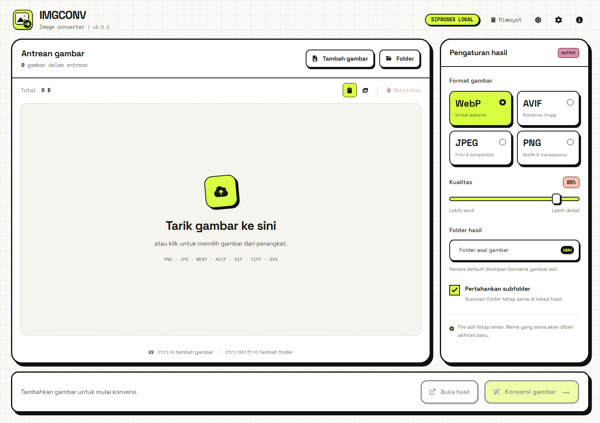

# Image to WebP


**Aplikasi desktop Windows untuk mengonversi banyak gambar ke WebP, AVIF, JPEG, dan PNG — langsung di perangkat Anda.**

[](https://github.com/kuro-usagi-labs/image-to-webp/releases/latest)
[](https://github.com/kuro-usagi-labs/image-to-webp/releases/latest)
[](https://github.com/kuro-usagi-labs/image-to-webp/actions/workflows/ci.yml)
[](LICENSE)

Image to WebP, dengan antarmuka **ImgConv**, membantu menyiapkan foto produk, gambar artikel, banner, dan aset website. Tambahkan file atau satu folder, pilih format serta kualitas, lalu jalankan konversi batch. Tidak perlu akun, server upload, atau koneksi internet untuk melakukan konversi.



*Antrean gambar menjadi area utama; pengaturan berada di sidebar dan tombol konversi tetap terlihat saat daftar digulir. Screenshot menampilkan keadaan awal aplikasi.*

## Unduh untuk Windows

**Versi terbaru: v2.5.3 · Windows x64**

| Pilihan | Cocok untuk | Unduhan |
| --- | --- | --- |
| Installer | Pemakaian sehari-hari; pasang aplikasi melalui wizard Windows | [Image-to-WebP-Setup-2.5.3.exe](https://github.com/kuro-usagi-labs/image-to-webp/releases/download/v2.5.3/Image-to-WebP-Setup-2.5.3.exe) |
| Portable | Menjalankan aplikasi tanpa instalasi | [Image-to-WebP-2.5.3.exe](https://github.com/kuro-usagi-labs/image-to-webp/releases/download/v2.5.3/Image-to-WebP-2.5.3.exe) |
| Checksum | Memeriksa integritas file unduhan | [SHA256SUMS.txt](https://github.com/kuro-usagi-labs/image-to-webp/releases/download/v2.5.3/SHA256SUMS.txt) |

[Lihat seluruh rilis dan catatan perubahan](https://github.com/kuro-usagi-labs/image-to-webp/releases) · [Changelog](CHANGELOG.md)

Pengguna aplikasi **tidak perlu memasang Node.js atau Python**. Keduanya hanya relevan untuk pengembangan source; aplikasi Electron sudah dibundel dalam file unduhan.

> Build saat ini belum ditandatangani dengan sertifikat code signing. Windows dapat menampilkan peringatan penerbit tidak dikenal atau SmartScreen. Pastikan file berasal dari halaman Releases repo ini dan cocokkan checksum bila diperlukan. Build untuk ARM64, Windows 32-bit, macOS, dan Linux belum disediakan.

## Cara menggunakan

1. Buka aplikasi, lalu tarik gambar ke workspace atau gunakan **Tambah gambar** / **Folder**. Folder dipindai sampai subfoldernya.
2. Tinjau antrean melalui tampilan daftar atau grid. Klik gambar untuk preview, atau hapus file yang tidak dibutuhkan.
3. Pilih **WebP, AVIF, JPEG, atau PNG**, lalu atur kualitas. Pilih folder hasil jika ingin menyimpannya di lokasi lain.
4. Tekan **Konversi gambar** atau `Ctrl+Enter`. Progres dan status ditampilkan di panel bawah.
5. Gunakan **Buka hasil** untuk membuka lokasi output. Riwayat per file dapat dilihat melalui tombol **Riwayat**.

Jika folder hasil tidak dipilih, setiap output disimpan bersama gambar asalnya. File asli tetap dipertahankan. Nama yang sudah ada tidak ditimpa: aplikasi memakai akhiran seperti `foto_1.webp`, `foto_2.webp`, dan seterusnya.

## Fitur

- **Konversi batch lokal.** Tambahkan beberapa file atau folder sekaligus, dengan deduplikasi path pada antrean.
- **Empat format hasil.** Gunakan WebP/AVIF untuk aset web, JPEG untuk foto dengan kompatibilitas luas, atau PNG untuk grafik dan transparansi.
- **Kontrol kualitas dan output.** Preferensi format, kualitas, lokasi hasil, tema, dan struktur subfolder disimpan antarsesi.
- **Orientasi foto otomatis.** Orientasi EXIF diterapkan sebelum encoding.
- **Antrean yang mudah ditinjau.** Tampilan list/grid, thumbnail, preview, navigasi gambar, dan hapus file per item.
- **Progres dan pembatalan.** Pekerjaan yang masih mengantre dapat dibatalkan; file yang sedang dikonversi diselesaikan terlebih dahulu.
- **Log konversi.** Lihat keberhasilan, kegagalan, dan informasi perubahan ukuran per file.
- **Integrasi Windows.** Tray dan aksi klik kanan **Convert to WebP** untuk format yang didukung pada build terpasang.
- **Tema terang/gelap.** Pilih tema aplikasi atau ikuti pengaturan sistem. Font antarmuka dibundel lokal.

### Format yang didukung

| Input | Output |
| --- | --- |
| PNG, JPG/JPEG, WebP, AVIF, GIF, TIFF/TIF, SVG | WebP, AVIF, JPEG, PNG |

Batas yang perlu diketahui:

- BMP belum didukung oleh decoder bawaan.
- GIF animasi dan TIFF multipage diproses sebagai frame/page pertama; pelestarian animasi atau semua halaman belum tersedia.
- JPEG tidak menyimpan transparansi.
- Hasil tidak selalu lebih kecil. Ukuran bergantung pada gambar, format, dan kualitas; aplikasi menampilkan penghematan maupun pertambahan ukuran.
- Menutup jendela menyembunyikan aplikasi ke tray. Untuk benar-benar keluar, pilih **Keluar** dari menu tray.

### Pintasan keyboard

| Pintasan | Aksi |
| --- | --- |
| `Ctrl+O` | Tambahkan gambar |
| `Ctrl+Shift+O` | Tambahkan folder |
| `Ctrl+Enter` | Mulai konversi |
| `Esc` | Tutup dialog atau preview |
| `←` / `→` | Pindah gambar saat preview |
| `Delete` | Bersihkan antrean ketika tidak sedang mengedit input |

## Privasi dan keamanan

Gambar diproses secara lokal menggunakan Sharp. Aplikasi tidak mengunggah gambar ke layanan konversi. Fitur upload WordPress telah dihapus sejak v2.5.0; pengaturan dan kredensial WordPress lama dibersihkan saat startup versi baru.

Renderer menggunakan sandbox, context isolation, CSP, dan IPC yang memvalidasi asal request. Preferensi yang dapat diakses renderer dibatasi ke pengaturan konversi. Tetap gunakan versi terbaru ketika mengolah file dari sumber luar.

## Mengembangkan dari source

Kebutuhan: **Windows x64, Node.js 26+, dan Git**.

```powershell
git clone https://github.com/kuro-usagi-labs/image-to-webp.git
cd image-to-webp
npm ci
node node_modules/electron/install.js
npm start
```

Langkah instalasi Electron eksplisit diperlukan jika kebijakan npm menunda install script paket tersebut. Source aplikasi aktif menggunakan **Electron + vanilla JavaScript/CSS + Sharp**; runtime tidak membutuhkan prototype Python di direktori `legacy/`.

### Pengujian

```powershell
npm test
npm run test:electron
npm run test:ui
npm audit
```

- `npm test`: regresi konversi dengan Sharp/filesystem asli, perilaku renderer dengan jsdom, keamanan IPC, serta manifest rilis.
- `test:electron`: main/preload/UI nyata pada profil sementara, termasuk konversi, sandbox, dan CSP.
- `test:ui`: layout beberapa ukuran jendela, gulir antrean/dock, font lokal, dan axe pada tema serta dialog. Capture dan hasil pemeriksaan ditulis ke `artifacts/ui/`.

Pengujian tidak memakai akun pengguna atau layanan WordPress. CI menjalankan pemeriksaan ini pada runner Windows.

### Build dan rilis

```powershell
npm run build:win
npm run release:checksums
```

Hasil berada di `dist-electron/`: installer, portable, metadata update, blockmap, dan `SHA256SUMS.txt`. Build standar menghasilkan aplikasi unsigned dengan ikon dan metadata produk. Untuk alur signed, lihat [BUILDING.md](BUILDING.md).

Untuk memeriksa file yang sudah diunduh:

```powershell
Get-FileHash .\Image-to-WebP-Setup-2.5.3.exe -Algorithm SHA256
```

Bandingkan hasilnya dengan baris file yang sama di `SHA256SUMS.txt`.

Maintainer dapat menggunakan workflow manual [Publish Windows release](https://github.com/kuro-usagi-labs/image-to-webp/actions/workflows/release.yml) setelah tag versi didorong. Workflow memeriksa kesesuaian tag, menjalankan tes, membuat build/checksum, mengunggah aset sebagai draft, lalu menerbitkan release. Detailnya ada di [panduan build](BUILDING.md).

## Struktur proyek

```text
electron-main.js      Lifecycle aplikasi, dialog native, dan IPC
preload.js            API terbatas untuk renderer
lib/                  Konversi dan validasi pengaturan
ui/                   Antarmuka, ikon, dan font lokal
scripts/              Launcher, pengujian Electron, build, dan checksum
tests/                Regresi otomatis
docs/                 Screenshot, release notes, dan arsip desain lama
legacy/               Prototype historis, tidak dibundel ke aplikasi
```

Artefak build, konfigurasi layanan development, sertifikat, environment lokal, dan catatan kerja lokal dikecualikan dari Git. File executable didistribusikan melalui **GitHub Releases**, bukan disimpan dalam riwayat source.

## Bantuan dan kontribusi

Laporkan bug melalui [GitHub Issues](https://github.com/kuro-usagi-labs/image-to-webp/issues). Sertakan versi aplikasi, versi Windows, format input/output, serta langkah reproduksi. Untuk kontribusi, baca [CONTRIBUTING.md](CONTRIBUTING.md).

Dibuat oleh **Gilang / kuro-usagi-labs**. Source tersedia di bawah [MIT License](LICENSE). Lisensi font lokal disertakan di `ui/assets/fonts/`; distribusi aplikasi juga memuat pemberitahuan lisensi dependency-nya.
